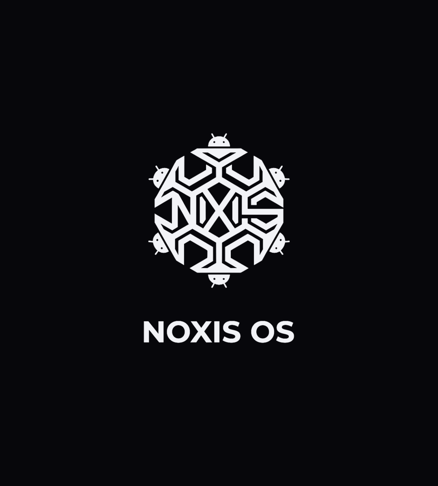
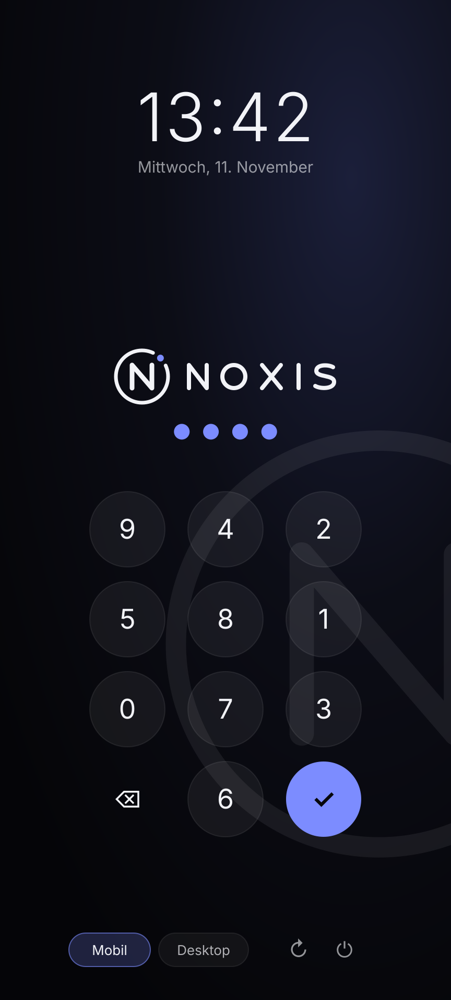

<p align="center">
  
</p>

<h1 align="center">Noxis Linux</h1>

<p align="center">
  OPSEC-gehärtetes Mobile Linux – Debian trixie (arm64) + Phosh, eigener Display-Manager, eigener Kernel-Build<br>
  Zielgerät: <b>Nothing Phone (3a)</b> – <code>asteroids</code>, Snapdragon 7s Gen 3 (SM7635), Adreno 810
</p>

<p align="center">
  <a href="LICENSE"></a>
  <a href="https://buymeacoffee.com/3rr0r303YT"></a>
  
</p>

> ⚠️ **Alpha.** Rootfs, OPSEC-Schicht, Display-Manager und Kernel-Build sind getestet, der erste Boot auf dem 3a noch nicht.
> Erst mit `fastboot boot` testen, nicht flashen.

| Login (noxis-dm + Greeter) | Startbildschirm |
|---|---|
|  |  |

## Funktionen

- **Eigener Display-Manager `noxis-dm`** – PAM + logind, Greeter als eigener Systemnutzer, PIN-Feld bei jedem Start neu gemischt, Sperre nach Fehlversuchen
- **Desktop-Modus** – externer Bildschirm → Desktop-Anordnung, Bildschirmtastatur aus
- **Firewall-Killswitch** – eingehend dicht, ausgehend nur über Mullvad (WireGuard)
- **DNS** – Quad9 über DNS-over-TLS, kein Fallback
- **USB-Sperre** – gesperrter Bildschirm → keine neuen USB-Geräte, kein USB-Datenmodus
- **Tastatur** – keine Wortvorhersage, Lerndaten nur im RAM
- **Browser** – Tor Browser (aarch64, GPG-geprüft), Firefox mit arkenfox
- **Kernel** – aus den offiziellen Nothing-Quellen, mit Yama, Landlock, ohne User-Namespaces/kexec
- **Builds** – `git --depth=1`, Signaturprüfung, SHA-256, automatisches Aufräumen

## Schnellstart

```bash
./build-noxis-linux.sh check
./build-noxis-linux.sh all            # → ~/Desktop/noxis-linux/{rootfs.img,rootfs-sparse.img,SHA256SUMS}
# Gentoo / ohne Debian-Werkzeuge:
./build-noxis-linux.sh container
# Kernel aus den Nothing-Quellen (vorher, optional):
sudo ./build-noxis-linux.sh kernel     # → ~/Desktop/noxis-linux/{boot.img,device/*.deb}
sudo ./build-noxis-linux.sh container  # nimmt device/*.deb automatisch ins Rootfs
```

Optionen: `NOXIS_USER=noxis NOXIS_PIN=147147 NOXIS_DEVICE_DEBS=<ordner> BOOT_IMG=<datei>`

## 1. Roadmap

| Phase | Inhalt | Stand |
|---|---|---|
| 1 | OPSEC-Schicht `noxis-opsec` (Firewall, Mullvad, DNS, USB, Tastatur, Härtung) | **fertig, getestet** |
| 2 | Rootfs-Build: Debian trixie arm64, Phosh + noxis-dm, Tor, Firefox+arkenfox, Waydroid | **fertig, Ablauf getestet** |
| 3 | Image: `rootfs.img` (ext4) + Sparse, SHA-256, Auto-Cleanup | **fertig, getestet** |
| 4 | Kernel aus `NothingOSS/android_kernel_msm-6.1_nothing_sm7635` + eigene Module + Initramfs → `boot.img` | **Skript fertig, Config getestet, Build ungetestet** |
| 5 | Erster Boot: UFS, USB-Debug-Netz, systemd | wartet auf Test am Gerät |
| 6 | Anzeige/Touch/GPU über Qualcomm-Treiber (msm_drm, kgsl, focaltech) unter Phosh | offen |
| 7 | WLAN (qcacld-3.0), Modem, Audio, Kamera | offen |

**Warum blockiert:** Droidian (Halium/libhybris) unterstützt Vendor-Partitionen bis Android 13 (api33).
Das 3a läuft mit Android-15-Vendor + GKI-Kernel – dafür gibt es noch keinen Halium-Port.
Mainline-Linux kann auf dem 3a bisher nur Framebuffer, Taschenlampe und Debug-UART.
Sobald es einen Kernel gibt: `NOXIS_DEVICE_DEBS=<ordner mit linux-bootimage-*.deb + adaptation-*.deb> ./build-noxis-linux.sh all`.

## 2. Paket-Matrix

| Bereich | Paket | Quelle | Prüfung |
|---|---|---|---|
| Oberfläche | `phosh-core`, `cage`, `gir1.2-gtk-4.0`, `noxis-shell` (noxis-dm) | Debian + Noxis | apt-Signatur |
| Tastatur | `squeekboard` (keine Wortvorhersage) | Debian | apt |
| Tastatur-Konflikt | `phosh-osk-stevia`, `phosh-osk-stub` (Vorhersage) | – | per `Conflicts` ausgeschlossen |
| Netzwerk | `network-manager`, `modemmanager`, `wpasupplicant`, `bluez` | Debian | apt |
| Firewall | `nftables` + `/etc/noxis/firewall.nft` | Debian + Noxis | `nft -c` |
| VPN | `mullvad-vpn` | repository.mullvad.net (arm64) | Schlüssel-Fingerabdruck `A119 8702 … 66DE 8DDF` |
| DNS | `systemd-resolved` (Quad9 DoT) | Debian | – |
| USB | `usbguard` + `noxis-usblock` | Debian + Noxis | D-Bus-Test |
| Browser | `firefox-esr` + arkenfox (`defaults/pref`) | Debian + GitHub `--depth=1` | – |
| Mobile-Firefox | `mobile-config-firefox` | Debian (optional) | apt |
| Anonym | Tor Browser Linux aarch64 (16.x) → `/opt/tor-browser` | dist.torproject.org | GPG `EF6E 286D … 9329 8290` |
| Isolation | `waydroid` | Debian (optional) | apt |
| Telefonie | `gnome-calls`, `chatty` | Debian | apt |
| Entfernt | `openssh-server`, Autologin, Coredumps | – | – |

## 3. systemd-Units (`noxis-opsec`)

| Unit | Aufgabe |
|---|---|
| `noxis-firewall.service` | lädt `/etc/noxis/firewall.nft` vor `network-pre.target` |
| `noxis-mullvad-setup.service` | `lockdown-mode on`, `auto-connect on`, `lan block`, DNS Quad9 im Tunnel |
| `noxis-mullvad-setup.timer` | prüft den Killswitch alle 5 min, setzt ihn neu |
| `noxis-usblock.service` | gesperrt → USBGuard blockiert neue Geräte + USB-Gadget getrennt (Laden bleibt) |
| `mullvad-early-boot-blocking.service` | Mullvad blockiert schon vor dem Netzstart |

### Firewall (`/etc/noxis/firewall.nft`)

* **eingehend:** `policy drop` – nur loopback, Antworten, DHCP, IPv6-Nachbarschaft, Waydroid-DNS/DHCP
* **ausgehend:** `policy drop` – nur `wg0-mullvad`, Mullvads eigener Verbindungsaufbau (`fwmark 0x6d6f6c65`), DHCP, IPv6-ND
* **weiterleiten:** Waydroid nur in den Tunnel
* läuft **zusätzlich** zu Mullvads eigener Killswitch-Tabelle

### Weitere Härtung

| Datei | Wirkung |
|---|---|
| `resolved.conf.d/90-noxis.conf` | Quad9 nur über DoT, kein Fallback, kein LLMNR/mDNS |
| `journald.conf.d/90-noxis.conf` | Protokolle nur im RAM |
| `coredump.conf.d/90-noxis.conf` | keine Speicherabbilder |
| `sysctl.d/90-noxis.conf` | kptr/dmesg restrict, BPF/kexec/ptrace aus, IPv6-Privacy, kein Ping |
| `NetworkManager/conf.d/90-noxis.conf` | Zufalls-MAC, kein Hostname an DHCP, keine Konnektivitätsprüfung |
| `user-tmpfiles.d/noxis-osk.conf` | Squeekboard-/Presage-Daten → `/run/user/UID` (tmpfs) |

## 4. Tests

```bash
sudo ./test/test_firewall.sh                      # Pakettest in Netz-Namespaces (auf deinem PC)
dbus-run-session -- python3 test/test_usblock.py  # USB-Sperre über echten D-Bus (8 Tests)
sudo ./test/test_build.sh <arkenfox/user.js>      # Build-Ablauf, echte GPG-/ext4-Prüfung (25 Tests)
```


## Kernel (`kernel/`)

| Datei | Zweck |
|---|---|
| `build-noxis-kernel.sh` | klont Nothing-Kernel (`--depth=1`), Config, baut Image.gz + In-Tree- + externe Module (Display, GPU, Touch, Fences, SecureMSM), Initramfs, `boot.img` (Header v4), `.deb`-Pakete |
| `noxis.config` | systemd-Bedarf (devtmpfs, fhandle, SysV-IPC, autofs), nftables, USB-NCM, Härtung (Yama, Landlock, kein userns/kexec), kein LTO/BTF |
| `initramfs/init` | lädt First-Stage-Module, findet `userdata`, mountet `modem`/`dsp` des aktiven Slots, `switch_root` → systemd |
| `modules/` | Ladelisten + Blocklist aus dem 3a-Gerätebaum |

**Erst testen, nicht flashen** (Telefon im Bootloader, `fastboot` am PC):

```bash
fastboot getvar current-slot
fastboot boot ~/Desktop/noxis-linux/boot.img            # einmalig, nichts wird überschrieben
```

Debug-Modus (USB-Netz + Shell, ohne Rootfs):

```bash
NOXIS_CMDLINE="console=tty0 noxis.debug=1" sudo -E ./build-noxis-linux.sh kernel
fastboot boot ~/Desktop/noxis-linux/boot.img
sudo ip addr add 172.16.42.2/24 dev usb0   # Name des USB-Netzes am PC prüfen: ip link
telnet 172.16.42.1
dmesg | tail -50; ls /sys/class/udc /dev/dri
```

Flashen (löscht Android-Daten; zurück nur mit Nothing-Firmware):

```bash
fastboot flash boot boot.img
fastboot flash userdata rootfs-sparse.img
fastboot reboot
```

Firmware für WLAN/Modem/GPU (vorher unter Android): `adb pull /vendor/firmware ~/noxis-fw`, dann
`NOXIS_FIRMWARE=~/noxis-fw sudo -E ./build-noxis-linux.sh kernel` – das Paket nur lokal nutzen.

## Oberfläche (`noxis-shell`)

| Teil | Datei | Funktion |
|---|---|---|
| Display-Manager | `/usr/lib/noxis/dm/noxis-dm` | eigener DM: startet Greeter als `noxis-greeter` (PAM-Klasse greeter), prüft PIN per PAM (`/etc/pam.d/noxis`), startet Phosh als Benutzer (logind, Rechteabgabe, umask 077), nach Abmelden zurück zum Greeter; nur erlaubte Sitzungen, Greeter darf keine `LD_PRELOAD` & Co. setzen |
| Anmeldung | `/usr/lib/noxis/greeter/noxis-greeter` | cage + GTK4, spricht das greetd-Protokoll mit noxis-dm: Uhr, Logo, PIN-Feld **neu gemischt** bei jedem Start/Fehlversuch, ab 4 Fehlern 30 s → max. 15 min Sperre, Modus Mobil/Desktop, Neustart/Aus |
| Desktop-Modus | `/usr/lib/noxis/noxis-dock` | externer Bildschirm erkannt → anschalten, anordnen, Bildschirmtastatur aus; abgesteckt → alles zurück |
| Branding | `/usr/share/noxis/branding/*.svg` | Logo, Wortmarke, App-Icon, Hintergründe hoch/quer |
| Startbildschirm | `/usr/share/plymouth/themes/noxis` | Plymouth: pulsierendes Logo, PIN-Abfrage für Verschlüsselung |

Einstellungen: `/etc/noxis/dm.conf` (VT, Greeter-Befehl, erlaubte Sitzungen) · `/etc/noxis/greeter.conf` (Benutzer, Mischen, PIN-Länge für Auto-Login-Taste) · `/etc/noxis/dock.conf` (Phone-Display an/aus, Position, Skalierung).

**Bildschirm am 3a:** USB-C nur 2.0, **kein DisplayPort** → USB-C-HDMI-Adapter liefern kein Bild.
Wege: DisplayLink-Adapter (eigener Grafikchip über USB, braucht `evdi` + DisplayLink-Treiber, ungetestet) oder Miracast über WLAN (`gnome-network-displays`, nur Spiegeln).
Auf Geräten mit Videoausgang (z. B. PinePhone mit Dock, Librem 5) springt der Desktop-Modus direkt an.

```bash
python3 test/test_shell.py      # 71 Tests: Protokoll, PIN, Sperre, Bildschirmerkennung, Anordnung, Branding, Paket
sudo python3 test/test_dm.py    # 26 Tests: noxis-dm mit echtem PAM, fork, Rechteabgabe, Sitzungsumgebung
```


## Alle Tests

```bash
./test/test_kernel.sh <nothing-kernel-quellen>       # 33
sudo ./test/test_build.sh <arkenfox/user.js>         # 25
python3 test/test_shell.py                           # 71
sudo python3 test/test_dm.py                         # 26
dbus-run-session -- python3 test/test_usblock.py     # 8
sudo ./test/test_firewall.sh                         # Pakettest in Netz-Namespaces
```

## Unterstützen

Wenn dir Noxis Linux gefällt, kannst du die Entwicklung unterstützen:

<a href="https://buymeacoffee.com/3rr0r303YT"></a>

## Lizenz

Noxis Linux ist freie Software unter der **GNU General Public License v3.0** – siehe [LICENSE](LICENSE).
Du darfst es nutzen, verändern und weitergeben, solange abgeleitete Werke ebenfalls unter der GPL-3.0 stehen und der Quellcode verfügbar bleibt.

```
Noxis Linux – Copyright (C) 2026 3rr0r (Real3rr0r303YT)
This program comes with ABSOLUTELY NO WARRANTY. This is free software, and you are
welcome to redistribute it under the conditions of the GNU GPL v3 or later.
```

Fremdkomponenten behalten ihre Lizenzen: Nothing-Kernel (GPL-2.0), Modullisten aus dem LineageOS-Gerätebaum (Apache-2.0), arkenfox (MIT), Tor Browser und Mullvad (eigene Lizenzen, werden beim Build geladen, nicht mitgeliefert).
Firmware-Blobs aus `/vendor/firmware` sind proprietär und gehören **nicht** ins Repository.
