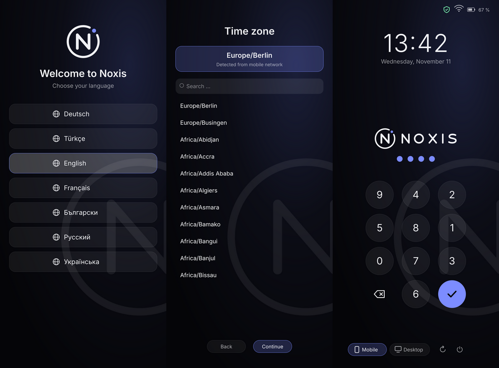

<p align="center">
  
</p>

<h1 align="center">Noxis Linux</h1>

<p align="center">
  OPSEC-hardened mobile Linux – Debian trixie (arm64) + Phosh, its own display manager and kernel build<br>
  Target device: <b>Nothing Phone (3a)</b> – <code>asteroids</code>, Snapdragon 7s Gen 3 (SM7635), Adreno 810
</p>

<p align="center">
  <a href="LICENSE"></a>
  <a href="https://buymeacoffee.com/3rr0r303YT"></a>
  
  
</p>

<p align="center"><b>Made by <a href="https://www.tiktok.com/@3rr0r303yt">3rr0r303YT on TikTok</a></b></p>

> Sister project: **[Noxis OS](https://github.com/Real3rr0r303YT/NoxisOS)** – the same OPSEC idea as hardened Android (LineageOS + KernelSU), with every piece of hardware working.

> ⚠️ **Alpha.** The rootfs, OPSEC layer, display manager and kernel build are tested; the first boot on the 3a is not.
> Test with `fastboot boot` first – do not flash.

## What's new – v1.1

- 🐉 **Kali Linux tools built in** – nmap, aircrack-ng, wifite, hcxdumptool, bettercap, Wireshark, hydra, john, hashcat, sqlmap, gobuster, ffuf and more from Debian
- 🐉 **Full Kali on demand** – `noxis-kali` starts a real Kali Linux container (Metasploit, `kali-linux-headless`), sharing the Noxis firewall and VPN
- 🤖 **Waydroid** – Android apps inside Linux (`sudo waydroid init` once)
- `NOXIS_PENTEST=0` builds without the pentest tools

<p align="center"></p>
<p align="center"><sub>First boot: language → time zone → login (renderings of the GTK4 greeter)</sub></p>

## Features

- **Own display manager `noxis-dm`** – PAM + logind, greeter runs as its own system user, PIN pad reshuffled on every start, lockout after failed attempts
- **7 languages** – Deutsch, Türkçe, English, Français, Български, Русский, Українська – chosen at build time or on the phone at first boot
- **Accurate time zone** – detected offline from the mobile network (MCC via ModemManager, no location services, no internet lookup), the build machine, or the language; full searchable list as fallback
- **Icons everywhere** – status row (VPN, network, battery), session chips (mobile / desktop), keypad and power buttons
- **Desktop mode** – external display → desktop layout, on-screen keyboard off
- **Firewall killswitch** – inbound closed, outbound only through Mullvad (WireGuard)
- **DNS** – Quad9 over DNS-over-TLS, no fallback
- **USB lock** – locked screen → no new USB devices, no USB data mode
- **Keyboard** – no word prediction, learning data in RAM only
- **Browsers** – Tor Browser (aarch64, GPG-verified), Firefox with arkenfox
- **Kernel** – from the official Nothing sources, with Yama and Landlock, without user namespaces/kexec
- **Kali Linux tools** – the common Kali tools from Debian, plus `noxis-kali` for a full Kali container (see [Pentest tools](#pentest-tools))
- **Waydroid** – run Android apps in a container
- **Builds** – `git --depth=1`, signature checks, SHA-256, automatic cleanup

## Installation auf dem Gerät

```sh
./build-noxis-linux.sh kernel      # boot.img + initramfs.cpio.lz4
./build-noxis-linux.sh container   # rootfs-sparse.img
./build-noxis-linux.sh flash       # vbmeta, userdata, boot, init_boot
```

`flash` zieht beim ersten Mal `init_boot` und `vbmeta` als Rohlinge vom Gerät
(dafür muss es in der Recovery mit `adb` erreichbar sein) und legt sie unter
`<Ausgabe>/stock/` ab. Zurück zur Stock-Bootkette, damit die Recovery wieder
startet: `./build-noxis-linux.sh restore` (`userdata` bleibt unangetastet;
`stock/boot.img` muss dafür aus einem Backup dort liegen).

Zwei Eigenheiten dieses Geräts, die der Befehl berücksichtigt und die man von
Hand leicht falsch macht:

- Die Ramdisk muss nach `init_boot`. Der Bootloader ignoriert die Ramdisk im
  `boot.img`, sobald eine `init_boot`-Partition existiert.
- Nur das Haupt-`vbmeta` darf mit `--disable-verity --disable-verification`
  geflasht werden. Werden `vbmeta_system` und `vbmeta_vendor` mitentschärft,
  bootet das Gerät gar nicht mehr und fällt sofort in fastboot zurück — auch
  mit Stock-Kernel und Stock-Recovery.

## Quick start

```bash
git clone --depth=1 https://github.com/Real3rr0r303YT/NoxisLinux
cd NoxisLinux
sudo ./build-noxis-linux.sh kernel      # kernel from the Nothing sources → ~/Desktop/noxis-linux/{boot.img,device/*.deb}
sudo ./build-noxis-linux.sh container   # rootfs in Docker; asks for language + time zone, picks up device/*.deb
```

On a Debian/Ubuntu host without Docker: `./build-noxis-linux.sh check` then `./build-noxis-linux.sh all`.

### Language and time zone

The build asks once:

```
  Language / Sprache / Dil / Langue / Език / Язык / Мова
    1) Deutsch
    2) Türkçe
    3) English
    4) Français
    5) Български
    6) Русский
    7) Українська
    0) ask on the phone at first boot
  > 2
  Time zone [Europe/Istanbul]:
```

The suggested time zone is your build machine's (`timedatectl`, `/etc/timezone` or `/etc/localtime` – works on OpenRC/Gentoo too), otherwise the language default. Without a terminal, or with `0`, the phone asks at first boot and suggests the zone from the SIM's mobile network.

Non-interactive:

```bash
NOXIS_LANG=tr NOXIS_TZ=Europe/Istanbul sudo -E ./build-noxis-linux.sh container
NOXIS_LANG=ask sudo -E ./build-noxis-linux.sh container      # choose on the phone
```

Other options: `NOXIS_USER=noxis NOXIS_PIN=147147 NOXIS_DEVICE_DEBS=<folder> BOOT_IMG=<file>`

## 1. Roadmap

| Phase | Content | Status |
|---|---|---|
| 1 | OPSEC layer `noxis-opsec` (firewall, Mullvad, DNS, USB, keyboard, hardening) | **done, tested** |
| 2 | Rootfs build: Debian trixie arm64, Phosh + noxis-dm, Tor, Firefox + arkenfox, Waydroid | **done, flow tested** |
| 3 | Image: `rootfs.img` (ext4) + sparse, SHA-256, auto-cleanup | **done, tested** |
| 4 | Kernel from `NothingOSS/android_kernel_msm-6.1_nothing_sm7635` + own modules + initramfs → `boot.img` | **script done, config tested, build untested** |
| 5 | First boot: UFS, USB debug network, systemd | waiting for a device test |
| 6 | Display/touch/GPU via Qualcomm drivers (msm_drm, kgsl, focaltech) under Phosh | built, waiting for a device test |
| 7 | Wi-Fi (WCN6750: icnss2 + qcacld-3.0), modem (QRTR, rmtfs, pd-mapper, tqftpserv, ModemManager), Bluetooth (btpower + hci_uart qca) | **built + bring-up written, waiting for a device test** |
| 8 | Audio (ADSP/AudioReach), calls with audio, GPS | open |
| 9 | Camera | open (Qualcomm camera stack is Android-only) |

**Why it is hard:** Droidian (Halium/libhybris) supports vendor partitions up to Android 13 (api33); the 3a ships an Android 15 vendor with a GKI kernel.
Mainline Linux on the 3a currently supports only framebuffer, flash LED and debug UART – hence the own kernel build from the Nothing sources.

## 2. Package matrix

| Area | Package | Source | Verification |
|---|---|---|---|
| UI | `phosh-core`, `cage`, `gir1.2-gtk-4.0`, `noxis-shell` (noxis-dm) | Debian + Noxis | apt signature |
| Keyboard | `squeekboard` (no word prediction) | Debian | apt |
| Keyboard conflict | `phosh-osk-stevia`, `phosh-osk-stub` (prediction) | – | excluded via `Conflicts` |
| Network | `network-manager`, `modemmanager`, `wpasupplicant`, `bluez` | Debian | apt |
| Firewall | `nftables` + `/etc/noxis/firewall.nft` | Debian + Noxis | `nft -c` |
| VPN | `mullvad-vpn` | repository.mullvad.net (arm64) | key fingerprint `A119 8702 … 66DE 8DDF` |
| DNS | `systemd-resolved` (Quad9 DoT) | Debian | – |
| USB | `usbguard` + `noxis-usblock` | Debian + Noxis | D-Bus test |
| Browser | `firefox-esr` + arkenfox (`defaults/pref`) | Debian + GitHub `--depth=1` | – |
| Mobile Firefox | `mobile-config-firefox` | Debian (optional) | apt |
| Anonymity | Tor Browser Linux aarch64 → `/opt/tor-browser` | dist.torproject.org | GPG `EF6E 286D … 9329 8290` |
| Isolation | `waydroid` | Debian (optional) | apt |
| Pentest | `nmap` `masscan` `aircrack-ng` `reaver` `hcxdumptool` `hcxtools` `wifite` `macchanger` `wireshark` `tshark` `tcpdump` `bettercap` `ettercap` `dsniff` `hydra` `john` `hashcat` `sqlmap` `gobuster` `ffuf` `sslscan` `binwalk` `radare2` `proxychains4` `socat` | Debian (`NOXIS_PENTEST=1`, default) | apt |
| Kali container | `podman` + `distrobox` → `kalilinux/kali-rolling` via `noxis-kali` | Debian + Docker Hub (official Kali image) | apt / registry |
| Telephony | `gnome-calls`, `chatty` | Debian | apt |
| Locales | de_DE, tr_TR, en_US, fr_FR, bg_BG, ru_RU, uk_UA (UTF-8) | Debian `locales` | – |
| Removed | `openssh-server`, autologin, core dumps | – | – |

## Pentest tools

Built in by default (turn off with `NOXIS_PENTEST=0 sudo -E ./build-noxis-linux.sh container`):

```bash
nmap -sV 192.168.1.0/24
sudo wifite                      # needs a USB Wi-Fi adapter with monitor mode (USB-C OTG)
sudo bettercap
wireshark                        # your user is in the wireshark group
```

Full Kali Linux in a container (first run downloads it, needs internet):

```bash
noxis-kali          # enter Kali (also in the app list as "Kali Linux")
noxis-kali full     # install kali-linux-headless (~3 GB)
noxis-kali remove   # delete the container
```

The container runs in root mode (Noxis kernels have no user namespaces) and uses the host network, so the firewall and VPN kill switch still apply.
The phone's built-in Wi-Fi (qca6750) has no monitor mode – use a USB Wi-Fi adapter for Wi-Fi attacks.
Only test networks and devices you own or have written permission to test.

## 3. systemd units (`noxis-opsec`)

| Unit | Job |
|---|---|
| `noxis-firewall.service` | loads `/etc/noxis/firewall.nft` before `network-pre.target` |
| `noxis-mullvad-setup.service` | `lockdown-mode on`, `auto-connect on`, `lan block`, Quad9 DNS inside the tunnel |
| `noxis-mullvad-setup.timer` | re-checks the killswitch every 5 min |
| `noxis-usblock.service` | locked → USBGuard blocks new devices + USB gadget detached (charging keeps working) |
| `mullvad-early-boot-blocking.service` | Mullvad blocks traffic before the network starts |

### Firewall (`/etc/noxis/firewall.nft`)

* **inbound:** `policy drop` – only loopback, replies, DHCP, IPv6 neighbour discovery, Waydroid DNS/DHCP
* **outbound:** `policy drop` – only `wg0-mullvad`, Mullvad's own connection setup (`fwmark 0x6d6f6c65`), DHCP, IPv6 ND
* **forward:** Waydroid only into the tunnel
* runs **in addition** to Mullvad's own killswitch table

### More hardening

| File | Effect |
|---|---|
| `resolved.conf.d/90-noxis.conf` | Quad9 over DoT only, no fallback, no LLMNR/mDNS |
| `journald.conf.d/90-noxis.conf` | logs in RAM only |
| `coredump.conf.d/90-noxis.conf` | no core dumps |
| `sysctl.d/90-noxis.conf` | kptr/dmesg restrict, BPF/kexec/ptrace off, IPv6 privacy, no ping |
| `NetworkManager/conf.d/90-noxis.conf` | random MAC, no hostname to DHCP, no connectivity check |
| `user-tmpfiles.d/noxis-osk.conf` | Squeekboard/Presage data → `/run/user/UID` (tmpfs) |

## 4. Kernel (`kernel/`)

| File | Purpose |
|---|---|
| `build-noxis-kernel.sh` | clones the Nothing kernel (`--depth=1`), config, builds Image.gz + in-tree + external modules (display, GPU, touch, fences, SecureMSM), initramfs, `boot.img` (header v4), `.deb` packages |
| `noxis.config` | systemd needs (devtmpfs, fhandle, SysV IPC, autofs), nftables, USB NCM, hardening (Yama, Landlock, no userns/kexec), no LTO/BTF |
| `initramfs/init` | loads first-stage modules, finds `userdata`, mounts `modem`/`dsp` of the active slot, `switch_root` → systemd |
| `modules/` | load lists + blocklist from the 3a device tree |

**Test first, do not flash** (phone in bootloader, `fastboot` on the PC):

```bash
fastboot getvar current-slot
fastboot boot ~/Desktop/noxis-linux/boot.img            # one-off, nothing is overwritten
```

Debug mode (USB network + shell, without rootfs):

```bash
NOXIS_CMDLINE="console=tty0 noxis.debug=1" sudo -E ./build-noxis-linux.sh kernel
fastboot boot ~/Desktop/noxis-linux/boot.img
sudo ip addr add 172.16.42.2/24 dev usb0   # check the interface name on the PC: ip link
telnet 172.16.42.1
dmesg | tail -50; ls /sys/class/udc /dev/dri
```

Flashing (wipes Android data; going back needs the Nothing firmware):

```bash
fastboot flash boot boot.img
fastboot flash userdata rootfs-sparse.img
fastboot reboot
```

Firmware for Wi-Fi, Bluetooth, GPU and DSPs – copy it from your own phone **while it still runs Android** (USB debugging on):

```bash
./tools/pull-firmware.sh ~/noxis-firmware
NOXIS_FIRMWARE=~/noxis-firmware/firmware sudo -E ./build-noxis-linux.sh kernel
```

The modem firmware does not need copying: the initramfs mounts the phone's own `modem` and `dsp` partitions read-only.
Firmware is proprietary – the package stays on your machine and never goes into this repository.

## 4b. Hardware bring-up (`noxis-hw`)

| Part | How it works on Noxis |
|---|---|
| Firmware | `noxis-firmware-links` links `/vendor/firmware_mnt/image` (modem partition), `/vendor/firmware` and `/vendor/dsp` into `/lib/firmware` before modules load – real Debian firmware is never replaced |
| Remote processors | `noxis-radios` boots the ADSP (`/sys/kernel/boot_adsp`), starts offline remoteprocs (modem, CDSP), like Android's `init.target.rc` |
| Wi-Fi | WCN6750 via `icnss2` + `qca_cld3_qca6750` (built from Nothing's sources, `volcano_gki_qca6750` profile), `fs_ready` signal → `wlan0` in NetworkManager, random MAC |
| Mobile network | QRTR (in-kernel name service) + `rmtfs` (modem storage via the `rmtfs` UIO region) + `pd-mapper` + `tqftpserv` → ModemManager (QMI over QRTR), data over `rmnet`/IPA |
| Bluetooth | `noxis-btpower` switches the rail (`/dev/btpower`, ioctl `0xbfad`), `btattach -P qca` on `/dev/ttyHS0` → BlueZ |

All traffic – Wi-Fi and mobile data – still leaves only through the Mullvad tunnel (`noxis-firewall`).

## 5. Shell (`noxis-shell`)

| Part | File | Function |
|---|---|---|
| Display manager | `/usr/lib/noxis/dm/noxis-dm` | starts the greeter as `noxis-greeter` (PAM class greeter), checks the PIN via PAM (`/etc/pam.d/noxis`), starts Phosh as the user (logind, dropped privileges, umask 077), back to the greeter after logout; only allowed sessions, the greeter cannot inject `LD_PRELOAD` & co. |
| First-boot setup | `/usr/lib/noxis/dm/setup.py` | language (7) + time zone; writes locale, `/etc/localtime`, keyboard layout (console + Phosh); only allowed while unconfigured |
| Greeter | `/usr/lib/noxis/greeter/noxis-greeter` | cage + GTK4, speaks the greetd protocol with noxis-dm: status icons, clock, logo, PIN pad **reshuffled** on every start/failure, lockout 30 s → max 15 min from the 4th failure, mobile/desktop session with icons, restart/power off |
| Desktop mode | `/usr/lib/noxis/noxis-dock` | external display detected → switch on, arrange, on-screen keyboard off; unplugged → everything back |
| Branding | `/usr/share/noxis/branding/*.svg` | logo, wordmark, app icon, portrait/landscape wallpapers |
| Boot splash | `/usr/share/plymouth/themes/noxis` | Plymouth: Noxis OS emblem, pulsing, PIN prompt for encryption |

Settings: `/etc/noxis/dm.conf` (VT, greeter command, allowed sessions) · `/etc/noxis/greeter.conf` (user, shuffling, PIN length for auto-submit) · `/etc/noxis/dock.conf` (phone display on/off, position, scale).

**External display on the 3a:** USB-C 2.0 only, **no DisplayPort** → USB-C-to-HDMI adapters show nothing.
Options: a DisplayLink adapter (own graphics chip over USB, needs `evdi` + the DisplayLink driver, untested) or Miracast over Wi-Fi (`gnome-network-displays`, mirroring only).
On devices with video out (e.g. PinePhone with dock, Librem 5) desktop mode kicks in directly.

## 6. Tests

```bash
./test/test_kernel.sh <nothing-kernel-sources>       # 33  config fragment, module lists, initramfs, packages
sudo ./test/test_build.sh <arkenfox/user.js>         # 25  build flow, real GPG/ext4 checks, safe cleanup
python3 test/test_shell.py                           # 78  protocol, PIN, lockout, displays, status icons, branding
sudo python3 test/test_dm.py                         # 26  noxis-dm with real PAM, fork, privilege drop
python3 test/test_locale.py                          # 73  7 languages, MCC → time zone, setup, build prompt
./test/test_hw.sh                                    # 27  firmware links, radio bring-up, Bluetooth power, units
dbus-run-session -- python3 test/test_usblock.py     # 8   USB lock over a real D-Bus
sudo ./test/test_firewall.sh                         #     packet test in network namespaces
```

## Support

If you like Noxis Linux, you can support its development:

<a href="https://buymeacoffee.com/3rr0r303YT"></a>

## License

Noxis Linux is free software under the **GNU General Public License v3.0** – see [LICENSE](LICENSE).
You may use, modify and share it, as long as derived works are also licensed under the GPL-3.0 and the source code stays available.

```
Noxis Linux – Copyright (C) 2026 3rr0r (Real3rr0r303YT)
This program comes with ABSOLUTELY NO WARRANTY. This is free software, and you are
welcome to redistribute it under the conditions of the GNU GPL v3 or later.
```

Third-party components keep their licenses: the Nothing kernel (GPL-2.0), module lists from the LineageOS device tree (Apache-2.0), arkenfox (MIT), Tor Browser and Mullvad (own licenses; downloaded during the build, not shipped).
Firmware blobs from `/vendor/firmware` are proprietary and do **not** belong in this repository.
